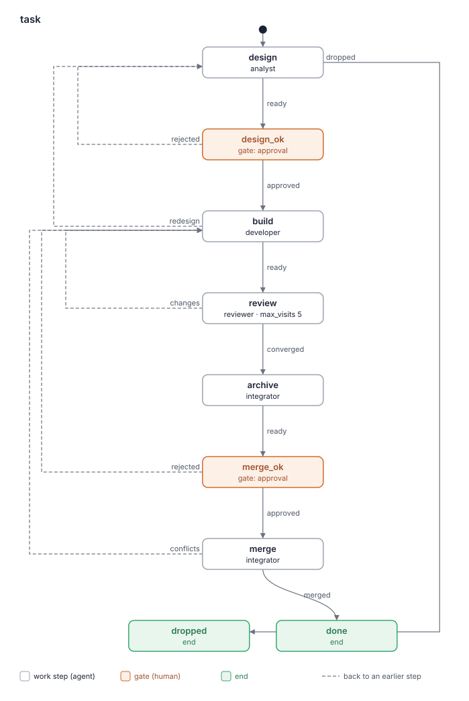

# Отчёт о ките: sdlc 0.1.0

- Дата: 2026-10-08
- Кит: worktree рана `create/comet` (`.lado/worktrees/kit-comet/create-comet`), путь дан задачей
- Коммит: 451aee4
- Оценил: критик kit-builder (слои a и b)
- Режим: полный. Предыдущего отчёта нет: артефакта `evaluation` в ране нет, а `kit-reports/` пуст. Блокеры B1 и B2 из `build-report` проверены ниже, в разделе «Прежние находки».
- Проходы: три независимых суб-агента. Каждый читал кит, рубрику и зависимые скилы (superpowers v6.4.1, grilling v1.2.3, tracker из tracker-jira-server v1.0.0) и начинал со своего места: 1 — kit.yaml и роли, 2 — флоу по шагам, 3 — скилы. 5 находок одного прохода отброшено, 6 оставлено как подтверждённые.

Находки — это кандидаты, которые взвешивает человек, а не оценка «прошёл / не прошёл».

## Карточка

| Слой | Результат |
|---|---|
| a. `lado kits check` | OK; 0 предупреждений |
| a. Бюджет | жёлтый; Worker roles = 4 (обосновано в блупринте: R12, R4) |
| a. Флоу | 1 нарисован; совпадает со скелетом блупринта |
| b. Рубрика | 15 находок (3 high, 10 medium, 2 low); у 4 из 12 критериев находок нет |
| Охват | полная оценка всего кита: 19 файлов |

### `lado kits check .`

```
sdlc: OK (4 agents, 10 skills, 2 packs and 1 flows)
expects skills: tracker
```

### Скрипт бюджета (код выхода 0)

```
# Complexity budget: sdlc 0.1.0

| Measure | Where | Value | Green / yellow up to | Zone |
|---|---|---|---|---|
| Worker roles (not supervisor) | kit | 4 | 3 / 5 | yellow |
| Work steps in a flow | flows/task.yaml | 5 | 5 / 8 | green |
| Gates in a flow | flows/task.yaml | 2 | 2 / 3 | green |
| Words in a role prompt | agents/analyst.md | 747 | 800 / 1500 | green |
| Words in a role prompt | agents/developer.md | 534 | 800 / 1500 | green |
| Words in a role prompt | agents/integrator.md | 486 | 800 / 1500 | green |
| Words in a role prompt | agents/reviewer.md | 384 | 800 / 1500 | green |
| Words in the lead's prompt | agents/supervisor.md | 589 | 1000 / 1500 | green |
| Own skills | kit | 4 | 5 / 10 | green |
| MCP servers | kit | 0 | 2 / 4 | green |

## Similar paragraphs (one rule, one place; 55% similar or more)

none

Overall: yellow
```

### Флоу



```
same as the plan in BLUEPRINT.md (exit status 0)
```

## Исправить в первую очередь

1. Найти причину красной проверки до того, как отдавать её разработчику. Причина в окружении уходит супервизору, а не в `conflicts` или находку (F3.1).
2. У ожидания CI в `merge` нужен потолок времени и маршрут для красного CI и для отказа хоста в мерже (F3.2).
3. Сказать аналитику, где остановить brainstorming и writing-plans: без Execution Handoff, без своих одобрений в чате и без реализации. Одобрение — это гейт `design_ok` (F5.1).
4. Добавить `reads: [design, merge-report]` шагу `merge` и `reads: [build-report]` шагу `design` (F2.1, F2.2).
5. Привести в соответствие `max_visits: 5` и число раундов ревью (F8.1).

## Находки

### 1. Границы ролей

Права каждой роли названы. Ревьюер: «You are read-only on the code» (`agents/reviewer.md:15`). Аналитик: «code is the developer's» (`agents/analyst.md:14`). Супервизор: «You change no code» (`agents/supervisor.md:11`). Мерж и записи в Jira при мерже делает только интегратор. Противоречие с правами ревьюера, которое создаёт зависимый скил, вынесено в F5.3.

### 2. Передача между шагами

- **F2.1** [medium] `flows/task.yaml:103` (state `merge`)
  > Merge the pull request as your role describes ("Merge"), with the plan and the Jira
  `merge` работает по `merge-report` (а по роли — и по `design`, где указана целевая ветка), но у шага нет `reads`. Артефакт пишет другой шаг (`archive`), и ни одна заметка не обязана его прикладывать. Объявление подменяет только текст роли: «in `merge`, your `merge-report`» (`agents/integrator.md:17`).
  Fix: добавить `reads: [design, merge-report]` в `merge`. Passes: 3/3

- **F2.2** [medium] `flows/task.yaml:20` (state `design`)
  > developer's reason for `redesign` (its `build-report` says what cannot be built as
  При `redesign` аналитик должен читать `build-report`, но у `design` нет `reads`, и шаг `build` не обязан прикладывать отчёт к заметке.
  Fix: `reads: [build-report]` в `design`. Такая форма допустима: `build` уже читает `ledger` до `review`, и `lado kits check` это принимает. Passes: 2/3

- **F2.3** [medium] `agents/analyst.md:32` (state `design`)
  > run's branch on the target: `git fetch origin` and `git reset --keep origin/<target>`.
  Супервизор коммитит `.lado/sdlc.md` локально: «Write and commit it only with their yes: it is their file.» (`agents/supervisor.md:23`). Пушить этот коммит его никто не просит. Ран стартует с локальной базовой ветки, а аналитик переставляет ветку рана на `origin/<target>`, где файла нет. Каждый следующий шаг упирается в «When the file is missing … stop» (`skills/sdlc-settings/SKILL.md:18`). То же относится к незапушенному `.lado/tracker.yaml`.
  Fix: супервизор перед первым раном проверяет, что файлы настроек есть на `origin/<base>`, и иначе просит человека запушить их. Либо аналитик после reset переносит их из базы. Passes: 1/3, confirmed (`agents/supervisor.md:32` «Start the run from the base branch» + `agents/analyst.md:32`: reset на удалённую ветку отбрасывает незапушенные коммиты базы)

### 3. Готовность и исходы

- **F3.1** [high] `agents/integrator.md:42` (state `merge`)
  > changes, run the settings' **Checks**; a red check is `conflicts` too. Otherwise push.
  Ещё `skills/review-loop/SKILL.md:66`: «request's CI state; a red check is a finding. A check must be able to fail». Любая красная проверка (а в `merge` — каждая, после того как цель влита) уходит разработчику как дефект работы. Ничто не отличает причину в работе от причины в окружении: нет инструмента, нет сети, флаки-раннер. Правило «A failure outside the kit» есть только у супервизора (`agents/supervisor.md:43`), рабочих ролей оно не касается. Итог — круг `build → review → archive → merge_ok` впустую, и разработчик может «чинить» код под окружение. В `task.yaml:108` при чистом мерже с красной проверкой сказано «abort the merge, push nothing», но прерывать уже нечего: мерж-коммит остаётся на ветке.
  Fix: одно правило в `engineering-rules`: сначала найти причину, например перезапустить упавшую проверку отдельно. Причина вне работы уходит супервизору через `send_message` с командой и выводом, и это не находка и не `conflicts`. Для чистого мержа с красной проверкой — `git reset --keep` на коммит, запомненный до мержа. Passes: 3/3 (влияние: high в двух проходах, medium в одном; взято high)

- **F3.2** [high] `agents/integrator.md:43` (state `merge`)
  > 2. Wait until the pull request's CI is green, then merge it with a merge commit, never
  У ожидания нет потолка. Нет и исхода для CI, который покраснел или не закончился, и для хоста, который отказал в мерже (защита ветки, нет approvals). У `merge` есть только `merged` и `conflicts`, поэтому интегратор либо ждёт бесконечно, либо отчитывается `conflicts` о том, что конфликтом не является.
  Fix: потолок ожидания из **Checks** настроек. Красный CI по вине работы → `conflicts` с упавшим job в note_body. Отказ хоста или таймаут → супервизору через `send_message`, ран остаётся в `merge`. Passes: 3/3 (high в двух проходах, medium в одном)

- **F3.3** [medium] `flows/task.yaml:74` (state `review`)
  > of `review-loop` holds after the cleanup pass and its final round, otherwise
  `converged` разрешён только при выполненном критерии остановки. Но после трёх внешних раундов `review-loop` велит спросить человека «and do as they say» (`skills/review-loop/SKILL.md:123-124`), а интегратор принимает и «or the human accepted the open findings, recorded in the ledger» (`agents/integrator.md:23`). Если человек принял открытые находки, `do` всё равно требует `changes`, и ран крутится до `max_visits`.
  Fix: добавить к условию `converged`: «or the human accepted the open findings, recorded in `ledger`». Passes: 1/3, confirmed (цитаты `review-loop:123` и `integrator.md:23` выше; другого условия для `converged` в `task.yaml:73-75` нет)

- **F3.4** [medium] `skills/review-loop/SKILL.md:120`
  > and external round) after the cleanup found nothing to fix.
  Дешёвая minor-находка получает fate `fix`: «cheap (the file is already open, no new test needed), otherwise `decline` with the» (`:50`). При этом «Minor findings do not start another round.» (`:122`). Если финальный раунд нашёл дешёвую minor, правило `:120` не выполнено, а `:122` говорит, что нового раунда нет. Условия `converged` и `changes` пересекаются, и ревьюеры выберут по-разному.
  Fix: сказать, что против финального раунда считаются только blocker и important, а minor из него отклоняется (`decline`) или уходит в коммит архива. Passes: 1/3, confirmed (три строки `review-loop:50, 120, 122` выше)

### 4. Независимая проверка

Работу разработчика проверяет отдельная роль `reviewer`. Гейт `design_ok` читает `design`, гейт `merge_ok` читает `ledger` и `merge-report` (`flows/task.yaml:61, 95`). Обойти ревью нельзя: `build` ведёт только в `review` или `design`.

### 5. Противоречия

- **F5.1** [high] `agents/analyst.md:71` (state `design`)
  > scale write the design doc and, with `writing-plans`, the plan under `docs/superpowers/`;
  Зависимый скил writing-plans заканчивается Execution Handoff. Он спрашивает человека «Which execution approach would you prefer?» и требует `subagent-driven-development` / `executing-plans`, то есть реализацию; в ките этих скилов нет. brainstorming ставит свои HARD-GATE-одобрения в чате (сначала спек, потом план), предлагает Visual Companion в браузере, а на пути «Bounded» заканчивается шагом «5. **Implement**». Противовес у аналитика один — «code is the developer's» (`agents/analyst.md:14`). Аналитик может задать человеку лишние вопросы на одобрение, которые дублируют `design_ok`, или начать реализацию до гейта. (Известная дыра 5)
  Fix: одна строка в analyst.md: «From `brainstorming` and `writing-plans` take the method only: no approvals in chat (the gate `design_ok` is the approval), no execution handoff, no implementation, mock-ups as artifacts, not the visual companion.» Passes: 3/3 (high в одном проходе, medium в двух; взято high, потому что ран может уйти в код до гейта)

- **F5.2** [medium] `agents/analyst.md:51` (state `design`)
  > why (scope, non-goals, acceptance), then on how. Ask a round as one message: numbered
  brainstorming велит «Ask clarifying questions — one at a time» и «Only one question per message». Роль и grilling велят задавать раунд одним сообщением. Какой стиль победит, зависит от рана.
  Fix: «Rounds of numbered questions, as `grilling` shapes them, replace brainstorming's one-at-a-time questions.» Passes: 2/3

- **F5.3** [medium] `skills/review-loop/SKILL.md:83` (state `review`)
  > Push before you ask: the external reviewer reads what is pushed. Request the round as the
  Раздел External round выполняет ревьюер, а его роль запрещает «change no file, branch or commit; no checkout, reset or stash in the run's worktree,» (`agents/reviewer.md:16`). Скил велит read-only-роли пушить. (Известная дыра 5, read-only-роль)
  Fix: «The developer pushes in `build`; the reviewer checks that the remote head is the head it reviews, and never pushes.» Passes: 1/3, confirmed (`review-loop:83` и `reviewer.md:16` выше; External round запускает только ревьюер, `review-loop:68`)

- **F5.4** [medium] `agents/analyst.md:42`
  > | hotfix | a defect with a clear symptom | proposal with the symptom and the suspected cause, delta spec when a rule changes, tasks | precision pass and one external round, unless the diff proves risky |
  Для hotfix и tweak обещан лёгкий ревью. Но `do` шага `review` разрешает `converged` только «after the cleanup pass and its final round» (`flows/task.yaml:74`). Человек одобряет одну глубину, а ревьюер выполняет другую — по-разному от рана к рану.
  Fix: в `do` шага `review` (или в `review-loop`, «Stop criterion») сказать, что для hotfix и tweak cleanup и отдельный финальный раунд пропускаются. Либо поменять таблицу. Passes: 1/3, confirmed (`analyst.md:42` и `task.yaml:74`; в `review-loop` нет исключения по масштабу)

### 6. Дублирование

- **F6.1** [low] `flows/task.yaml:50`
  > and resolve it). When the change is already archived, revert the archive commit
  Правило повторено в роли («When the change is already archived, revert the archive first», `agents/developer.md:60`) и в `openspec-changes` («After the archive»). Правило о ручных назначении и метке тоже записано трижды: `skills/sdlc-settings/SKILL.md:57-58`, `agents/analyst.md:23-25`, `agents/integrator.md:51-53`.
  Fix: оставить правило в одном месте (`openspec-changes` / `sdlc-settings`), а в остальных — короткий указатель. Passes: 2/3

- **F6.2** [medium] `skills/review-loop/SKILL.md:123`
  > declined is a stop signal. After 3 external rounds, if the criterion still fails, ask the
  Предел внешних раундов зашит в скил, хотя настройки проекта хранят свой: «- Round cap: 3» (`skills/sdlc-settings/sdlc.example.md:58`, раздел **External reviewer**, «the round cap»). Если проект поставит 2 или 4, две копии разойдутся.
  Fix: «After the round cap of **External reviewer** (`sdlc-settings`)». Passes: 1/3, confirmed (обе строки выше)

### 7. Когда звать человека

- **F7.1** [medium] `agents/developer.md:31`
  > needs another scope, a decision is missing), stop and report `redesign` with what and why;
  Единственный выход разработчика — `redesign`. Его зависимые скилы велят «Ask your human partner» (test-driven-development) и «Discuss with your human partner before attempting more fixes» (systematic-debugging). Роль не говорит, к человеку идти напрямую или через супервизора, и что делать при блокировке (тест не проходит, нет инструмента). У ревьюера то же самое: «ask them during your step» (`agents/reviewer.md:38`) без канала. Аналитику канал назван (`send_message` / `ask_human`, `agents/analyst.md:16-17`).
  Fix: одна строка в developer.md и reviewer.md: каким инструментом идёт вопрос к человеку, или что он идёт супервизору через `send_message` с контекстом и рекомендацией. Passes: 3/3

### 8. Циклы на повторном визите

- **F8.1** [medium] `flows/task.yaml:71` (state `review`)
  > Visits hold up to 3 external rounds, the cleanup pass and the final round.
  Один визит — один раунд (`flows/task.yaml:66`). Первый локальный раунд с исправлениями, три внешних раунда, cleanup и финальный раунд дают 6 визитов и больше, а `max_visits: 5` (`:62`). Визиты после отказа на `merge_ok` или после `conflicts` идут в тот же счёт. Лимит достигается на обычном ране, и `supervisor.md:49-50` («recommend going on») не говорит, что значит «продолжить».
  Fix: поднять `max_visits` (например, до 7) или считать раунды внутри визита; сказать, что делать на лимите. Passes: 3/3

### 9. Краткость и «зачем»

Правила несут причину, например «A pushed branch's `@{upstream}` diff is empty, and a review of nothing looks clean» (`skills/review-loop/SKILL.md:57-58`) и «the merge often succeeds while a local step of the tool fails» (`agents/integrator.md:46-47`). Филлера и no-op не найдено, промпты в зелёной зоне.

### 10. Описания скилов

У каждого своего скила в description есть «Use when / Use at»; `review-loop` и `engineering-rules` ссылаются друг на друга как соседи. Каждый скил из `skills:` роли ей нужен. Объявленные папки зависимостей совпадают с используемыми. `tracker` объявлен в `expects.skills` (`kit.yaml:11-12`).

### 11. Нейтральность к провайдеру

Названий инструментов CLI, моделей и конфигов нет. Скилы обращаются к своим файлам через `${SKILL_DIR}` (`skills/review-loop/SKILL.md:61, 67`, `skills/sdlc-settings/SKILL.md:20`). `gh` упомянут как инструмент хоста из настроек проекта («or the settings' tool's equivalent», `agents/integrator.md:44`).

### 12. Безопасность и рамки

- **F12.1** [medium] `agents/analyst.md:22` (state `design`)
  > 2. Move it to the settings' "in progress" status, unless it is there already, and read it
  Задача переводится в In Progress (шаг 2) раньше, чем проверяется, что она ещё нужна (шаг 4). При `dropped` статус никто не возвращает, и в Jira от имени человека висит «в работе» брошенная задача.
  Fix: поменять шаги 2 и 4 местами или сказать, что при `dropped` аналитик с согласия человека возвращает прежний статус. Passes: 3/3

## Известные дыры

| Известная дыра | Находка или чем кит её закрывает |
|---|---|
| 1. Красная проверка отправлена назад без поиска причины в окружении | F3.1 (ещё F3.2) |
| 2. Работа вне флоу, мерж без гейта | Закрыта: мерж стоит после `merge_ok`; «Write and commit it only with their yes» (`agents/supervisor.md:23`); `git pull --ff-only` только «when it is on the base branch and `git status --short` is empty» (`agents/supervisor.md:58`) |
| 3. Путь вне worktree рана | Закрыта: «Work only inside the run's worktree, with absolute paths» (`skills/engineering-rules/SKILL.md:49`). Связанная потеря файла настроек — F2.3 |
| 4. Вердикт без порога серьёзности | Закрыта: «the last round found no blocker and no confirmed important finding» (`skills/review-loop/SKILL.md:116`); пересечение для minor — F3.4 |
| 5. Зависимый скил пишет или спрашивает там, где роли нельзя | F5.1 (brainstorming / writing-plans у аналитика), F5.3 (review-loop велит read-only-ревьюеру пушить), F7.1 (TDD / debugging «ask your human partner» у разработчика без канала) |

## Не прослежено

Нет. Каждая роль, шаг, гейт и скил названы в таблице трассировки (раздел 3), MCP-серверов нет. Единственная жёлтая мера (4 рабочие роли) обоснована в разделе 4 (R12, R4). `--compare`: «same as the plan in BLUEPRINT.md».

## Прежние находки

Предыдущего отчёта критика нет, поэтому проверены блокеры, которые называет `build-report`:
- B1 (`tracker` из другого кита) — RESOLVED: `kit.yaml:11-12` «expects:» / «skills: [tracker]», `kit.yaml:14` «lado: ">=0.29"»; `lado kits check` печатает «expects skills: tracker».
- B2 (`tracker` не умеет назначать задачу) — RESOLVED: «`tracker` cannot assign a task yet: when» (`agents/analyst.md:23`), правило в `skills/sdlc-settings/SKILL.md:57-58`.

## Вопросы к человеку

Нет вопросов.

