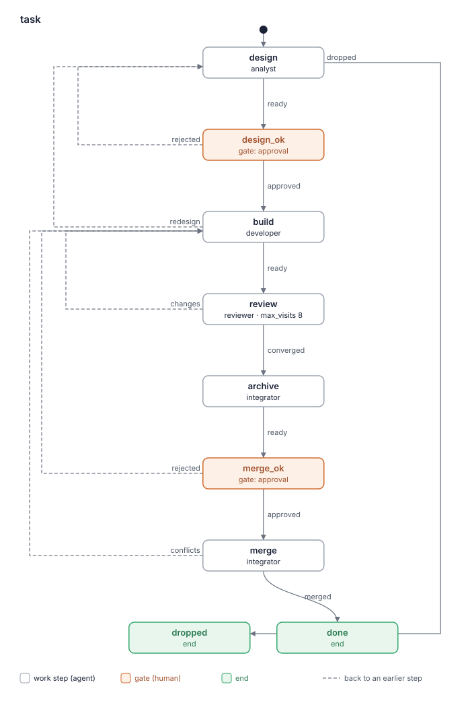

# Отчёт о ките: sdlc 0.2.1

- Дата: 2026-10-09
- Кит: worktree рана `improve/sdlc-2` (`.lado/worktrees/kit-sdlc/improve-sdlc-2`), путь дан задачей
- Коммит: ead915c (визит 2 шага `evaluate`). Визит 1 оценивал bf57458 (отчёт — коммит 4d931b4).
- Оценил: критик kit-builder (слои a и b)
- Режим: повторная оценка относительно `kit-reports/sdlc-0.2.0-2026-10-09.md` (артефакт `assessment`, коммит 29a4c8f), плана (`plan`) и отчёта визита 1. База — коммит из плана, b6fe2b7. Правки после визита 1: `git diff bf57458 ead915c -- kit.yaml README.md BLUEPRINT.md agents flows skills` — 5 файлов: `skills/sdlc-settings/SKILL.md` (раздел «Writing to the tracker»), по строке в `README.md`, `agents/analyst.md`, `agents/integrator.md`, раздел 4 `BLUEPRINT.md`. Мерж 4b561b7 принёс с main только `BACKLOG.md` (`git diff --name-only bf57458 4b561b7`), текста кита не трогал.
- Проходы, визит 2: дельта — один раздел скила и три строки ролей, поэтому три прохода по ней и по местам, которые на неё ссылаются (`agents/analyst.md` «Taking the task», `agents/integrator.md` «Archive» и «Merge» шаг 5, tracker SKILL.md v1.1.0 и его `jira.py`), критик сделал сам, без суб-агентов. Затем проверка вырезанных правил по `git diff --word-diff bf57458 ead915c` и полный проход: `skills/sdlc-settings/SKILL.md` целиком, `agents/analyst.md` и `agents/integrator.md` целиком, `README.md` раздел «Install and start», `BLUEPRINT.md` раздел 4 (остальной блупринт дельта не трогала; полный проход визита 1 по всем этим файлам — суб-агент). Новых находок 2, обе low; одиночных отброшенных нет.
- Визит 1: три прохода критика по дельте и полный проход суб-агента по 7 файлам; 4 находки полного прохода подтверждены (F3.4, F3.5, F6.4, F3.6).

Находки — это кандидаты, которые взвешивает человек, а не оценка «прошёл / не прошёл».

## Карточка

| Слой | Результат |
|---|---|
| a. `lado kits check` | OK; 0 предупреждений |
| a. Бюджет | жёлтый; Worker roles = 4 (обосновано в блупринте: R12, R4) |
| a. Флоу | 1 нарисован; совпадает со скелетом блупринта |
| b. Рубрика | 2 находки в изменённом тексте (0 high, 0 medium, 2 low), потерянных правил нет; 10 из 12 критериев без находок |
| Охват | повторная оценка изменённого текста (визит 2: раздел «Writing to the tracker» и три строки ролей и README), с полным проходом по `sdlc-settings`, аналитику и интегратору |
| Правило остановки | выполнено: 0 high, 0 medium в изменённом тексте |

Счёт относится только к тому, что указано в строке «Охват». С полной оценкой (`assessment`) его сравнивать нельзя.

### `lado kits check .`

```
sdlc: OK (4 agents, 10 skills, 2 packs and 1 flows)
expects skills: tracker
```

### Скрипт бюджета (код выхода 0)

```
# Complexity budget: sdlc 0.2.1

| Measure | Where | Value | Green / yellow up to | Zone |
|---|---|---|---|---|
| Worker roles (not supervisor) | kit | 4 | 3 / 5 | yellow |
| Work steps in a flow | flows/task.yaml | 5 | 5 / 8 | green |
| Gates in a flow | flows/task.yaml | 2 | 2 / 3 | green |
| Words in a role prompt | agents/analyst.md | 797 | 800 / 1500 | green |
| Words in a role prompt | agents/developer.md | 606 | 800 / 1500 | green |
| Words in a role prompt | agents/integrator.md | 646 | 800 / 1500 | green |
| Words in a role prompt | agents/reviewer.md | 419 | 800 / 1500 | green |
| Words in the lead's prompt | agents/supervisor.md | 753 | 1000 / 1500 | green |
| Own skills | kit | 4 | 5 / 10 | green |
| MCP servers | kit | 0 | 2 / 4 | green |

## Similar paragraphs (one rule, one place; 55% similar or more)

none

Overall: yellow
```

### Флоу



```
same as the plan in BLUEPRINT.md
```
(код выхода 0)

## Исправить первым

Блокирующего нет. Обе новые находки — low, по фразе каждая; ещё круг ради них не нужен.

## Находки

### 1. Границы ролей

Изменение прав не трогает. Назначает задачу только аналитик (`agents/analyst.md:27-28`); правило назначения в `sdlc-settings` его не расширяет. Без находок.

### 2. Передача между шагами

Изменение не трогает ни `reads`, ни `produces`. Без находок.

### 3. Готовность и исходы

- **F3.7** [low] `skills/sdlc-settings/SKILL.md:78`
  > `  human in your note to do it by hand. Assign to the account `tracker` works as; when`
  «when someone else has the task, ask the human first» требует знать, что текущий исполнитель — не аккаунт `tracker`. Чтение задачи показывает исполнителя отображаемым именем (`jira.py`: `print("Assignee: %s   Reporter: %s" % (` с `_name(...)`, `:546-547`), а имя своего аккаунта агенту не дано. Аналитик то спросит человека о задаче, которая уже на нём (лишний вопрос), то сочтёт её своей. Вред мал: в худшем случае лишний вопрос, чужую задачу молча он не заберёт.
  Fix: «…when the task has an assignee and you cannot tell it is that account, ask the human first». Passes: 3/3 (проходы критика)

### 4. Независимая проверка

Изменение не трогает ревью и гейты. Без находок.

### 5. Противоречия

- **F5.3** [low] `skills/sdlc-settings/SKILL.md:56`
  > `task, and read the task back after each write: a reported success is not proof that the`
  Вводная фраза требует перечитывать задачу и не верить сообщению об успехе, а пункты под ней для исполнителя, метки и ссылки принимают именно сообщение `tracker`: «- an assignee or label as `tracker` reports it after the write, or its "already so";» (`:62`), «- a write the task does not show (a link) by `tracker`'s own result; say so in your note.» (`:63`). Агент, следующий пунктам, прав; следующий вводной — лишний раз читает задачу. Вредного исхода нет.
  Fix: «…and check each write after it: a success line alone is not proof unless the list below says so. Check each write by…». Passes: 2/3 (проходы критика)

### 6. Дублирование

Без находок. Оговорка «как просит `tracker`» теперь в одном месте: «- **Comments** are written in Markdown as the skill `tracker` asks text to be written,» (`skills/sdlc-settings/SKILL.md:74`); интегратор ссылается: «tracker", **Comments**). Write it from the pull request's description and the change's» (`agents/integrator.md:30`).

### 7. Когда звать человека

Без находок. Новый случай «someone else has the task» ведёт к человеку («ask the human first», `skills/sdlc-settings/SKILL.md:78-79`); у аналитика, единственного, кто назначает, прямой разговор с человеком (`agents/analyst.md:16-18`).

### 8. Циклы на повторном визите

Не применимо к изменению: циклов оно не трогает.

### 9. Краткость и «почему»

Без находок. Пункты списка короче прежнего абзаца; причина «it formats it and adds its mark» на месте (`skills/sdlc-settings/SKILL.md:65-66`). Аналитик 797 слов, в зелёной зоне.

### 10. Описания скилов

Без находок. README требует id комментария от трекер-кита: «status and post a comment and report its id, and, when it can, link a URL, assign the task and label it.» (`README.md:20`); tracker-jira-server 1.1.0 его даёт (tracker SKILL.md:60-61).

### 11. Нейтральность к провайдеру

Без находок. Новые строки — по смыслу: «`tracker`'s mark», «the account `tracker` works as», «its "already so"»; ни команд, ни флагов, ни файлов tracker-jira-server.

### 12. Безопасность и рамки

Без находок. Новое правило делает назначение безопаснее: чужую задачу — только после вопроса человеку. «yes, create» на месте (`skills/sdlc-settings/SKILL.md:67`).

## Известные дыры

| Известная дыра | Находка или как кит её закрывает |
|---|---|
| 1. Красная проверка отправлена назад без поиска причины в окружении | Изменение не трогает; закрыта, как в `assessment` (`skills/engineering-rules/SKILL.md:40`) |
| 2. Работа вне флоу, мерж без гейта | Изменение не трогает; мерж после `merge_ok` |
| 3. Путь вне worktree рана | Изменение не добавляет путей |
| 4. Вердикт без порога серьёзности | Изменение не трогает (`skills/review-loop/SKILL.md:131`) |
| 5. Зависимый скил пишет или спрашивает там, где роли нельзя | Изменение не меняет `skills:` ролей; `tracker` по-прежнему нет у ревьюера |

## Не прослежено

Нет. `--compare`: «same as the plan in BLUEPRINT.md». Жёлтая мера (Worker roles = 4) обоснована. Раздел 4 блупринта совпадает с выводом скрипта (analyst 797, integrator 646). R16 (`BLUEPRINT.md:94-100`) по-прежнему описывает правило: «A write is checked by what `tracker` gives back for it» — правка визита 2 его уточняет, не меняет.

## Прежние находки

Отчёт визита 1 (4d931b4): 3 находки и 1 в «Пропущено ранее». Список автора (заметка `build`, `build-report`) сверен с файлами.

- **F3.4** RESOLVED: README — «status and post a comment and report its id, and, when it can, link a URL, assign the task and label it.» (`README.md:20`); `sdlc-settings` — «  id, find the comment by `tracker`'s mark as the newest in your name, and say so in» (`skills/sdlc-settings/SKILL.md:59`).
- **F3.5** RESOLVED: «- an assignee or label as `tracker` reports it after the write, or its "already so";» (`skills/sdlc-settings/SKILL.md:62`).
- **F6.4** RESOLVED: оговорка в пункте **Comments** (`skills/sdlc-settings/SKILL.md:74-75`), у интегратора ссылка (`agents/integrator.md:29-30`).
- **F3.6** (Пропущено ранее) RESOLVED: «   the account `tracker` works as (`sdlc-settings`, "Writing to the tracker").» (`agents/analyst.md:28`); чужая задача — «someone else has the task, ask the human first.» (`skills/sdlc-settings/SKILL.md:79`).

Находки плана (из `assessment`), RESOLVED в визите 1, проверены снова: F10.1 (`README.md:24`, `:56`), F3.1 (`skills/sdlc-settings/SKILL.md:57-66`, теперь списком), F6.2 (`agents/developer.md:58`), F5.1 (теперь через **Comments**, `agents/integrator.md:29-30`), F5.2 (`agents/analyst.md:28`) — все по-прежнему RESOLVED.

F2.1, F3.2, F3.3, F10.2, F6.1, F6.3 — STILL OPEN, оставлены планом (см. ниже); `flows/` и `skills/openspec-changes/` не менялись.

## Вырезанные правила

Визит 2 (`git diff --word-diff bf57458 ead915c`):

| Убранное правило (файл:строка в bf57458) | Где оно теперь |
|---|---|
| «a status, assignee or label as the task now shows it, by meaning» (`skills/sdlc-settings/SKILL.md:58-59`) | статус — «- a status as the task now shows it, by meaning;» (`:61`); исполнитель и метка — по сообщению `tracker` (`:62`), это и есть F3.5 |
| «A write the task does not show (a link) is confirmed by `tracker`'s own result; say so in your note.» (`:60-61`) | `:63`, тем же смыслом, пунктом списка |
| «Never compare the text you sent with the text the tracker keeps: it formats it and adds its mark.» (`:59-60`) | `:65-66`, без изменений |
| «Comments are written in Markdown and handed to `tracker` as they are» (`:69-70`) | `:74-75`, с добавкой «as the skill `tracker` asks» |
| «in Markdown, written as the skill `tracker` asks text to be written» (`agents/integrator.md:29-30`) | пункт **Comments** `sdlc-settings` (`:74`), интегратор ссылается (`agents/integrator.md:29-30`) |
| «the human (`tracker`'s account) when it is not» (`agents/analyst.md:28`) | «the account `tracker` works as» (`agents/analyst.md:28`); «when it is not» заменено повтором без вреда (`tracker` отвечает «already so») и вопросом человеку при чужом исполнителе (`skills/sdlc-settings/SKILL.md:78-79`) |
| значения раздела 4 (`BLUEPRINT.md`: analyst 800, integrator 650) | вывод скрипта: 797, 646 |

Ни одно правило не потеряно.

## Пропущено ранее

Нет.

## Оставлено планом

- F2.1, F3.2, F3.3, F10.2 — человек: «a separate run right after this one, for the archive path as a whole» (план, «Answers»); записано в `BACKLOG.md` (6923c79, в ветке рана после мержа 4b561b7).
- F6.1, F6.3 — low, в `BACKLOG.md` (план, «Leave (low, to BACKLOG.md)»).

## Вопросы человеку

1. Две новые low (F3.7, F5.3) — выпускать без них? Рекомендация: да, выпускать 0.2.1 и записать обе в `BACKLOG.md` (или взять в следующий ран по пути архивации). Обе — по фразе, вредного исхода нет: в худшем случае лишний вопрос человеку или лишнее чтение задачи.
