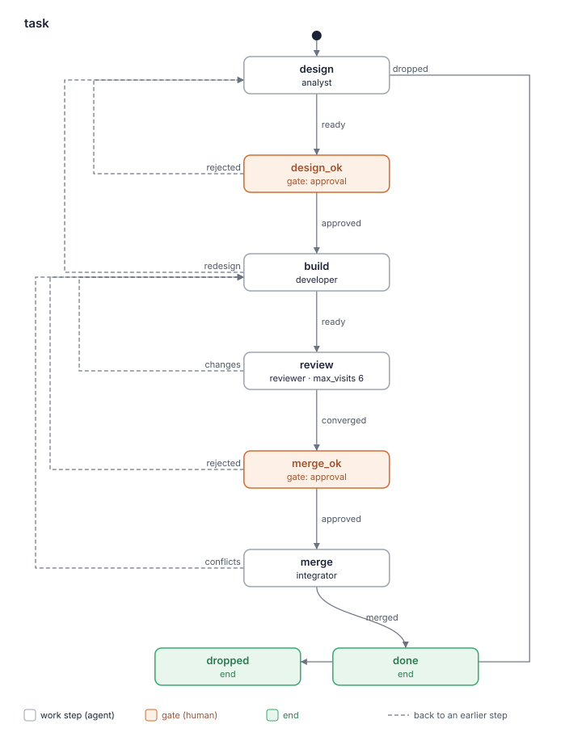

# Отчёт о ките: sdlc 0.4.0

- Дата: 2026-10-11
- Кит: worktree рана `improve/sdlc-4` (`.lado/worktrees/kit-sdlc/improve-sdlc-4`), путь дан задачей
- Коммит: 5e0eccc (визит 2 шага `evaluate`). Визит 1 оценивал 77d4dc1; его отчёт — коммит b8907b2.
- Оценил: критик kit-builder (слои a и b)
- Режим: повторная оценка.
  - Сравнивается с `kit-reports/sdlc-0.3.0-2026-10-09.md` (артефакт `assessment`, коммит 0985152), планом (`plan`) и `build-report`.
  - База — коммит из плана, 0985152 (текст кита как в cc15ba4). Изменение — `git diff 0985152 -- kit.yaml README.md BLUEPRINT.md agents flows skills`: 12 файлов, +180 −197 строк. Сюда входит и блупринт из `triage` (acde552).
- Проходы, визит 2:
  - Дельта: `git diff b8907b2 5e0eccc` — 3 файла, +6 −5 строк. Это правки F8.1 и F8.2 по комментарию человека на `release_ok` («чиним оба»).
  - Три прохода критика по дельте и связанным местам (шаг 1 «Merge» интегратора, «Archive» и «After the archive» `openspec-changes`, «Fixing» разработчика, разделы 3 и 5 блупринта), затем проверка вырезанных правил по `git diff --word-diff b8907b2 5e0eccc`, затем полный проход по 3 файлам дельты.
  - Одиночных отброшенных нет; подтверждённых оставлено 2 (F6.1, F8.3).
- Проходы, визит 1: критик сам, без суб-агентов. Три прохода по дельте и связанным местам, каждый со своей точки входа: 1 — `kit.yaml` и роли; 2 — `flows/task.yaml` по состояниям; 3 — `openspec-changes`, `review-loop` с `lenses.md`, потом снова роли. Связанные места: «Fixing» и «Report» разработчика, «Merge» интегратора, «Each visit» и «The ledger» ревьюера, «After the archive», «Stop criterion» и «Closing report».
  - Проходы шли в одном контексте, поэтому независимыми их считать нельзя. Каждую находку критик подтвердил по файлам (`grep -nF`, `git diff`); в находках так и помечено.
  - Затем проверка вырезанных правил по `git diff --word-diff 0985152 77d4dc1` и таблице «Cut text» из `build-report`.
  - Затем полный проход по всем 12 файлам дельты целиком (правило 5 «Re-evaluation»).
  - Одиночных находок отброшено: 2 (low): `lenses.md` больше не требует пропускать находку чистки, для которой нужна недоступная проверка; в правиле про minor последнего раунда пропала причина «found in the final round». Обе — следствие решения человека убрать финальный раунд. Оставлено как подтверждённые: 2 (F8.1, F8.2).

- Шаг `assess` рана `improve/sdlc-5` (2026-10-12, задача LAD-11): текст кита с 5e0eccc не менялся (`git diff --stat 5e0eccc -- kit.yaml README.md BLUEPRINT.md agents flows skills` пуст; после него только `BACKLOG.md`), задача велит взять этот отчёт как оценку текущей версии. Так же сделал `assess` рана `improve/sdlc-4` с отчётом 0.3.0. Кит заново не оценивался. Повторены `lado kits check .` (LADO 0.34.0; тот же вывод), скрипт бюджета (код 0; то же, кроме числа слов `agents/integrator.md`: 563, а не 553 — отчёт цитировал вывод визита 1, до правки F8.1/F8.2; исправлено ниже) и флоу-скрипт (`task.svg` без изменений; `--compare`: «same as the plan in BLUEPRINT.md»).
  - Для триажа LAD-11 — места, где кит полагается на ключ задачи в имени change (`grep -rnE 'task key|<key>|<KEY>'`): `skills/sdlc-settings/SKILL.md:82-90` («Runs and openspec changes start with the task key as a name», «so the run, the change and the branch get the same name»); `skills/openspec-changes/SKILL.md:37-38` («`<name>` is kebab-case and starts with the task key as a name»); `skills/sdlc-settings/sdlc.example.md:20`; `agents/supervisor.md:33` (имя рана — остаётся); `BLUEPRINT.md:126` («Run, change and branch names are made from the task key») — требование блупринта тоже надо поправить, иначе кит разойдётся с ним. `skills/openspec-changes/SKILL.md:82` (`archive(<KEY>): <name>`) и путь отчёта `<name>-review.md` (`:35`) от префикса не зависят.
  - Имя change уже передаётся без префикса: аналитик пишет его в артефакт `design` («the change's name, the scope and out of scope», `agents/analyst.md:87`), а `build`, `review` и `merge` читают `design` (`reads: [design, …]`, `flows/task.yaml:44,70,98`). Ни одна роль сейчас не ищет change по префиксу; `openspec validate <name>` (`agents/developer.md:47`) и `openspec validate <change>` (`flows/task.yaml:25`) берут имя из этого контекста. Правила о конфликте имён (`clash`, «already exist») в ките нет; строки `Task:` в `proposal.md` тоже нет (`skills/openspec-changes/SKILL.md:27`).

Находки — это кандидаты, которые взвешивает человек, а не оценка «прошёл / не прошёл».

## Карточка

| Слой | Результат |
|---|---|
| a. `lado kits check` | OK; 0 предупреждений |
| a. Бюджет | жёлтый; Worker roles = 4 (обосновано в блупринте: R12, R4) |
| a. Флоу | 1 нарисован; совпадает со скелетом блупринта |
| b. Рубрика | 2 открытые находки в изменённом тексте (0 high, 0 medium, 2 low: F6.1, F8.3); F8.1, F8.2 визита 1 и F12.1 закрыты; F5.1 оставлена планом; 10 из 12 критериев без находок |
| Охват | повторная оценка изменённого текста; визит 1 — с полным проходом по 12 файлам дельты, визит 2 — по 3 файлам правок |
| Правило остановки | выполнено: 0 high, 0 medium |

Счёт относится только к тому, что указано в строке «Охват». С полной оценкой его сравнивать нельзя.

### `lado kits check .`

```
sdlc: OK (4 agents, 10 skills, 2 packs and 1 flows)
read-only roles: reviewer
expects skills: tracker
expects commands: git, openspec
```

Expects: `expects skills: tracker`, `expects commands: git, openspec`.

Read-only: `read-only roles: reviewer`; `dependencies.lado: ">=0.34"` (`kit.yaml:16`).

### Скрипт бюджета (код выхода 0)

```
# Complexity budget: sdlc 0.4.0

| Measure | Where | Value | Green / yellow up to | Zone |
|---|---|---|---|---|
| Worker roles (not supervisor) | kit | 4 | 3 / 5 | yellow |
| Work steps in a flow | flows/task.yaml | 4 | 5 / 8 | green |
| Gates in a flow | flows/task.yaml | 2 | 2 / 3 | green |
| Words in a role prompt | agents/analyst.md | 799 | 800 / 1500 | green |
| Words in a role prompt | agents/developer.md | 693 | 800 / 1500 | green |
| Words in a role prompt | agents/integrator.md | 563 | 800 / 1500 | green |
| Words in a role prompt | agents/reviewer.md | 463 | 800 / 1500 | green |
| Words in the lead's prompt | agents/supervisor.md | 751 | 1000 / 1500 | green |
| Own skills | kit | 4 | 5 / 10 | green |
| MCP servers | kit | 0 | 2 / 4 | green |

## Similar paragraphs (one rule, one place; 55% similar or more)

none

Overall: yellow
```

### Флоу



```
same as the plan in BLUEPRINT.md
```
(код выхода 0)

## Исправить в первую очередь

1. Строка `openspec-changes` в разделе 3 блупринта всё ещё говорит «only for a red CI» (F6.1). Это одна фраза; на агентов не влияет.

## Находки

### 1. Границы ролей

Без находок. Архив целиком перешёл к интегратору в `merge`, итоговый отчёт пишет ревьюер. Ревьюер не пишет файлов: «change no file, branch or commit» (`agents/reviewer.md:17`), теперь ещё и `read_only: true` (`:9`).

### 2. Передача между шагами

Без находок. `merge_ok` и `merge` читают то, что им нужно: «    reads: [ledger]» (`flows/task.yaml:90`), «    reads: [design, ledger]» (`flows/task.yaml:98`). Итоговый отчёт есть в `ledger` при каждом `converged`: «`ledger` with the closing report» (`flows/task.yaml:84`). `merge-report` убран отовсюду (`grep -rn merge-report` по киту пуст).

### 3. Готовность и исходы

Без находок. Отказ архива — явный `conflicts`: «Commit nothing; the integrator reports `conflicts`.» (`skills/openspec-changes/SKILL.md:80`); в `merge` do: «when the change cannot be archived, bringing the target in conflicts, or a local» (`flows/task.yaml:105`).

### 4. Независимая проверка

Без находок. Архив и мерж идут только после гейта, и гейт показывает, что принимается: «Archive the change and merge the pull request into its target branch, with the» / «findings the ledger leaves open?» (`flows/task.yaml:92-93`). Ревьюер читает код раньше отчёта автора: «`build-report` last: its account of the work must not set your view of it.» (`agents/reviewer.md:32`).

### 5. Противоречия

Без новых находок. `read_only` не мешает ревьюеру: он комментирует PR через CLI хостинга, итоговый отчёт пишет в артефакт, файл отчёта в репозитории пишет интегратор (`skills/openspec-changes/SKILL.md:81`). F5.1 — в «Оставлено планом».

### 6. Дублирование

- **F6.1** [low] `BLUEPRINT.md:229`
  > | `openspec-changes` | skill | R3, R9, R16 | How to create, validate and archive a change compatibly with the project's archive (analyst, developer, reviewer, integrator); undoing a pushed archive only for a red CI after the merge's push. |
  - После F8.1 кит откатывает архив при любой правке, меняющей спеку: «<archive commit>` only when a fix after it changes the spec: a new commit brings back the» (`skills/openspec-changes/SKILL.md:89`).
  - Строка раздела 3 блупринта осталась от визита 1 и с этим расходится. Раздел 5 изменение записал, а раздел 3 — нет. Агенты блупринт не читают, но следующий план будет сверяться с ним.

  Fix: «…; undoing a pushed archive when a fix after it changes the spec.» Passes: 1/3, confirmed (`grep -nF` находит строку в `BLUEPRINT.md:229`; `git diff b8907b2 5e0eccc -- BLUEPRINT.md` меняет только разделы 4 и 5)

Других находок нет. Правило «отказ архива → `conflicts`» стоит в трёх местах: роль, скил, do. В скиле и do это короткие указатели, полный текст — в роли (`agents/integrator.md:24-26`). Скрипт похожих абзацев не нашёл.

### 7. Когда звать человека

Без находок. После лимита раундов — человек: «cap, if the criterion still fails, ask the human with the open findings and your» (`skills/review-loop/SKILL.md:141`). Спор, который нельзя решить кодом, идёт к супервизору (`agents/reviewer.md:42-45`).

### 8. Циклы на повторном визите

F8.1 и F8.2 визита 1 закрыты (см. «Прежние находки»).

- **F8.3** [low] `agents/developer.md:71`
  > it, and run the checks again. For a red CI from `merge`, fix the failing job the note
  > names on top of the branch, as a finding (`openspec-changes`, "After the archive"). When
  - После F8.1 откат архива касается любого возврата из `merge`, если правка меняет спеку, в том числе после конфликта. Но ссылку на «After the archive» роль разработчика даёт только для красного CI.
  - Разработчик, правящий конфликт, найдёт правило только через описание скила: «or must fix something» / «after its archive» (`skills/openspec-changes/SKILL.md:7-8`).

  Fix: перенести ссылку в конец абзаца: «…as a finding. A fix after the archive follows `openspec-changes` ("After the archive").» Passes: 1/3, confirmed (цитаты найдены `grep -nF`; `git diff b8907b2 5e0eccc -- agents/developer.md` пуст)

Ревьюер на повторном визите отмечает прежние находки: «findings RESOLVED or STILL OPEN first.» (`flows/task.yaml:77`). `max_visits: 6` (`:69`) покрывает перечисленные визиты (`:78-80`).

### 9. Краткость и причины

Без находок. У новых правил есть причины: «cleanup edits working code, so it goes before the review, not after.» (`agents/developer.md:32`); «a test bent to» / «fit the code hides the defect it guarded;» (`agents/developer.md:85-86`). Слов в изменённых файлах стало меньше: 7798 → 7488 (`build-report`).

### 10. Описания скилов

Без находок. Описание `review-loop` больше не обещает отдельный шаг архива: «Use when you review a pull request or fix what a review found.» (`skills/review-loop/SKILL.md:8`). Линза чистки нужна разработчику, и `review-loop` у него в `skills:` (`agents/developer.md:8`).

### 11. Нейтральность к провайдеру

Без находок. Отказ от Codex CLI объявлен в README: «You need LADO 0.34 or newer (the reviewer is read-only; the kit does not run on Codex» (`README.md:17`). Это цена `read_only`, человек её принял (план, F12.1).

### 12. Безопасность и границы

Без находок. Архив и мерж — только после `merge_ok`. Комментарий в трекер интегратор пишет после гейта, без черновика на гейте, как решил человек (план, «Answers»); гейт говорит, что будет: «brings the target in, merges with a merge commit and updates the tracker.» (`flows/task.yaml:94`). F12.1 закрыта.

## Известные дыры

| Известная дыра | Находка или чем кит её закрывает |
|---|---|
| 1. Красная проверка без учёта причины в окружении | Закрыта: «A red check whose» / «cause is in the work (`engineering-rules`, "A red check") is `conflicts` too» (`agents/integrator.md:30-31`). Провал `openspec validate --strict` при архиве идёт в `conflicts` без такой оговорки, но `openspec` объявлен в `expects.commands`, а `--strict` проверяет содержимое |
| 2. Работа вне флоу, мерж без гейта | Закрыта: архив и мерж — шаг `merge` после `merge_ok` |
| 3. Путь вне worktree рана | Закрыта; откат ограничен `openspec/` (`skills/openspec-changes/SKILL.md:77-79`) |
| 4. Вердикт без порога серьёзности | Закрыта: «- the last round found no blocker and no confirmed important finding;» (`skills/review-loop/SKILL.md:129`) |
| 5. Зависимый скил пишет или спрашивает там, где роли нельзя | Закрыта. У read-only ревьюера есть `openspec-changes` и `review-loop`, в которых описаны записи (архив, «Fixing a finding»). Но эти записи адресованы аналитику, разработчику и интегратору, флоу ревьюеру их не поручает, а роль запрещает: «change no file, branch or commit» (`agents/reviewer.md:17`) |
| 6. Команды не совпадают с `expects.commands` | Закрыта: `expects commands: git, openspec`; `gh` не объявлен, его проверяет аналитик |
| 7. Read-only роли не совпадают с тем, что делают | Закрыта: (a) `read-only roles: reviewer`; (b) ревьюер ничего не пишет и не коммитит; (c) `dependencies.lado: ">=0.34"`; (d) README `:17` говорит про Codex CLI |

## Не прослежено

Ничего. `--compare` различий не печатает. Жёлтая мера (Worker roles = 4) обоснована (R12, R4). Новые элементы и правила названы в R8, R9, R15 и строках раздела 3 блупринта; пять строк раздела 5 ссылаются на ревью процесса и ответы `triage`.

## Прежние находки

| Находка | Статус | Чем подтверждено |
|---|---|---|
| F12.1 [medium] Ревьюер без `read_only` | RESOLVED | «read_only: true» (`agents/reviewer.md:9`); `read-only roles: reviewer`; `lado: ">=0.34"` (`kit.yaml:16`); README `:17` |
| F5.1 [medium] `tracker` не говорит свой аккаунт | STILL OPEN, оставлена планом | `git diff 0985152 -- skills/sdlc-settings/SKILL.md` пуст |

Изменения плана:

| Изменение | Статус | Чем подтверждено |
|---|---|---|
| C1 Архив внутри `merge` | RESOLVED | `outcomes: {changes: build, converged: merge_ok}` (`flows/task.yaml:87`); состояния `archive` нет; `merge-report` нигде нет; шаг 1 «Merge» (`agents/integrator.md:22-27`); «Archive in `merge`, after the human's approval at `merge_ok`» (`skills/openspec-changes/SKILL.md:67`). Узкое место отката — F8.1 |
| C2 Облегчённое ревью | RESOLVED | «**Round cap.** At most 2 external rounds for a full change and 1 for a hotfix or tweak;» (`skills/review-loop/SKILL.md:139`); раздела «Cleanup pass» нет; `max_visits: 6`; `Round cap: 2` (`sdlc.example.md:58`); чистка у разработчика (`agents/developer.md:30-32`, `lenses.md:41-44`) |
| C3 Ревьюер сначала читает код | RESOLVED | `agents/reviewer.md:30-32`, спор — «settle it by the code, a test or the spec, never by argument alone» (`:41`) |
| C4 Изменённые тесты в `build-report` | RESOLVED | `agents/developer.md:85-86` |
| C5 Строка метрик | RESOLVED | `skills/review-loop/SKILL.md:148-150`; отчёт при каждом `converged` (`agents/reviewer.md:51-52`) |
| C6 Заморозка правил | RESOLVED | `BACKLOG.md:3-4`; R15 блупринта |
| C7 Счёт и проза | RESOLVED | README (таблица шагов без `archive`), `version: 0.4.0`, `agents/supervisor.md:49`; раздел 4 блупринта совпадает с выводом скрипта |

Находки визита 1 этого отчёта:

| Находка | Статус | Чем подтверждено |
|---|---|---|
| F8.1 [medium] Откат архива только при красном CI | RESOLVED | «<archive commit>` only when a fix after it changes the spec: a new commit brings back the» (`skills/openspec-changes/SKILL.md:89`); «`openspec/changes/archive/` (a return from `conflicts`), skip the archive, but» (`agents/integrator.md:27`). Следы: F6.1, F8.3 |
| F8.2 [low] Файл итогового отчёта не обновляется | RESOLVED | «rewrite the closing report (`openspec-changes`, "Archive" 4), commit and push it.» (`agents/integrator.md:28`) |

Список автора «fixed / not fixed» в `build-report` совпадает с файлами (визиты 1 и 2).

## Вырезанные правила

Визит 2 (`git diff --word-diff b8907b2 5e0eccc`):

| Вырезанное правило (файл:строка в b8907b2) | Где оно сейчас |
|---|---|
| откат «only when a red CI after the merge's push needs a fix that changes the spec» (`skills/openspec-changes/SKILL.md:89`) | шире: «only when a fix after it changes the spec» (`:89`) |
| «skip this step» при изменении под `archive/` (`agents/integrator.md:27`) | «skip the archive, but rewrite the closing report» (`:27-28`) |

Визит 1:

`git diff --word-diff 0985152 77d4dc1`, сверено с таблицей «Cut text» автора:

| Вырезанное правило (файл:строка в 0985152) | Где оно сейчас |
|---|---|
| проверка сходимости перед архивом (`agents/integrator.md` «Archive» 1) | снята намеренно: решает гейт `merge_ok` (R9) |
| итоговый отчёт пишет интегратор, если его нет в ledger («Archive» 2) | ревьюер пишет его при каждом `converged` (`agents/reviewer.md:51-52`); в репозиторий — `openspec-changes` «Archive» 4 |
| чтение состояния PR: CI, можно ли мержить, цель («Archive» 3) | «Merge» 3–4 (`agents/integrator.md:35-46`) |
| черновик комментария в трекер («Archive» 4) | «Merge» 6 (`agents/integrator.md:49-53`) |
| состав `merge-report` | снят вместе с артефактом (план C1) |
| «revert the archive first» у разработчика | `openspec-changes` «After the archive», сужено до красного CI — F8.1 |
| «the integrator archives it again after the review» | `agents/integrator.md:22`: архив, если изменение не под `archive/`; файл отчёта при пропуске — F8.2 |
| раздел «Cleanup pass» `review-loop` | `lenses.md:41-44` и `agents/developer.md:30-32`; оговорка «need a check you cannot run» убрана (отброшенная одиночная находка, см. «Проходы») |
| условие финального раунда и правило про minor финального раунда | сняты по решению человека (предложение 3); «a minor finding of the last round gets `decline`» (`skills/review-loop/SKILL.md:135`) |
| «against the developer's `build-report`» в `review` do | снято намеренно (C3: `build-report` читается последним) |

## Пропущено ранее

Нет. Полный проход по 12 файлам дельты нового вне изменённого текста не нашёл.

## Оставлено планом

- F5.1 (действие «какой у меня аккаунт» у `tracker`): оставил человек на `release_ok` в `improve/sdlc-3`; записано в BACKLOG.md.
- Предложения 5, 8, 9 и флоу `quick`/`converge`: ждут реальных ранов (заморозка правил).

## Вопросы человеку

Нет вопросов. Вопрос визита 1 (чинить ли F8.1 и F8.2 при заморозке правил) человек решил на `release_ok`: «чиним оба». F6.1 и F8.3 — низкие следы этой правки; чинить их сейчас или нет, решать на гейте релиза.
